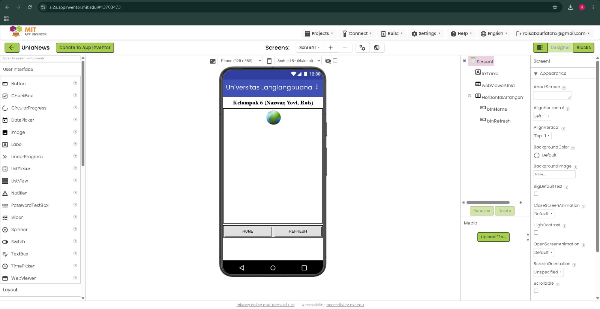
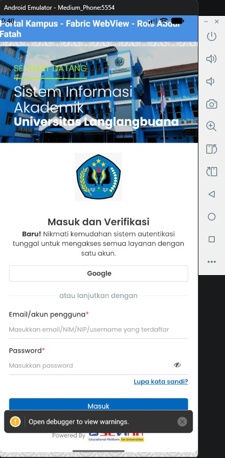

# Tugas Pemrograman Mobile: Implementasi WebView

Repositori ini berisi hasil pengerjaan tugas mata kuliah Pemrograman Mobile yang berfokus pada penerapan teknologi **WebView** untuk menampilkan halaman website di dalam aplikasi Android.

Terdapat dua implementasi menggunakan teknologi pengembangan aplikasi yang berbeda, yaitu MIT App Inventor dan React Native dengan dukungan Fabric (New Architecture).

## Daftar Tugas

| Tugas   | Teknologi                           | Lokasi Proyek              |
| ------- | ----------------------------------- | -------------------------- |
| Tugas 2 | MIT App Inventor (WebViewer)        | `MIT_App_Inventor_Tugas2/` |
| Tugas 3 | React Native CLI + Fabric + WebView | Direktori utama repositori |

---

## Tugas 2: Implementasi WebView dengan MIT App Inventor

Tugas ini merupakan pengembangan aplikasi Android sederhana menggunakan platform MIT App Inventor. Fitur utama aplikasi memanfaatkan komponen **WebViewer** untuk membuka dan menampilkan halaman website secara langsung melalui aplikasi.

**Desain di MIT App Inventor (Designer)**



**Tampilan di HP**


### Cara Membuka Proyek

1. Akses [MIT App Inventor](https://ai2.appinventor.mit.edu/).
2. Login menggunakan akun Google.
3. Masuk ke menu **Projects**.
4. Pilih **Import project (.aia) from my computer**.
5. Pilih file proyek MIT App Inventor yang tersedia di dalam folder `MIT_App_Inventor_Tugas2/`.
6. Setelah berhasil diimpor, proyek dapat dijalankan melalui:
   - **Connect > AI Companion** untuk mencoba aplikasi secara langsung menggunakan HP.
   - **Build > Android App (.apk)** untuk membuat file instalasi Android.

---

## Tugas 3: Implementasi WebView dengan React Native (Fabric)

Pada tugas ini, aplikasi dikembangkan menggunakan **React Native CLI** dengan mengaktifkan New Architecture yang mendukung sistem rendering Fabric.

Aplikasi memanfaatkan library `react-native-webview` untuk menampilkan halaman login portal akademik Universitas Langlangbuana (UNLA), sehingga pengguna dapat mengakses portal tersebut langsung dari aplikasi Android.

**Tampilan**



### Fitur Aplikasi

- Menampilkan header dengan identitas aplikasi dan nama pengembang.
- Memuat halaman portal akademik SIAKAD UNLA melalui WebView.
- Mengaktifkan JavaScript agar halaman website dapat berjalan dengan baik.
- Menggunakan SafeAreaView untuk mengatur area tampilan aplikasi.
- Mengimplementasikan Fabric melalui React Native New Architecture.

### Teknologi yang Digunakan

| Teknologi            | Versi / Keterangan |
| -------------------- | ------------------ |
| React Native         | 0.87.1             |
| React                | 19.2.3             |
| TypeScript           | TypeScript 6       |
| react-native-webview | ^14.0.1            |
| React Native CLI     | 20.2.0             |
| Fabric               | New Architecture   |
| Hermes               | Aktif              |

### Persyaratan Sistem

Sebelum menjalankan aplikasi, siapkan beberapa perangkat lunak berikut:

- Node.js versi minimal 22.11.0.
- npm.
- JDK 17.
- Android Studio atau Android SDK.
- Android Emulator atau HP Android dengan USB Debugging aktif.

### Cara Menjalankan Proyek

**1. Clone repositori**

Buka terminal atau CMD, kemudian jalankan:

```bash
git clone https://github.com/RoisAbdulFatah/TugasWebViewFabric.git
```

**2. Masuk ke direktori proyek**

```bash
cd TugasWebViewFabric
```

**3. Instal seluruh dependency**

```bash
npm install
```

**4. Jalankan Metro Bundler**

Buka terminal pertama dan jalankan:

```bash
npm start
```

**5. Jalankan aplikasi Android**

Buka terminal kedua pada direktori proyek yang sama, kemudian jalankan:

```bash
npm run android
```

Tunggu hingga proses build selesai dan aplikasi berhasil dijalankan pada emulator atau perangkat Android yang terhubung.

### Mengatasi Error Unable to Load Script

Apabila aplikasi menampilkan pesan kesalahan `Unable to load script`, kemungkinan perangkat Android belum terhubung dengan Metro Bundler.

Untuk mengatasinya, pastikan perangkat sudah terhubung melalui USB Debugging, kemudian jalankan perintah:

```bash
adb reverse tcp:8081 tcp:8081
```

Setelah itu, lakukan reload aplikasi.

### Konfigurasi Fabric (New Architecture)

Proyek ini menggunakan React Native New Architecture untuk mengaktifkan dukungan Fabric.

Pengaturan tersebut terdapat pada file:

```text
android/gradle.properties
```

Pastikan konfigurasi berikut tersedia:

```properties
newArchEnabled=true
```

Dengan konfigurasi tersebut, aplikasi menggunakan arsitektur baru React Native yang mendukung Fabric dan TurboModules.

### Struktur Direktori Proyek

```text
TugasWebViewFabric/
│
├── android/                   # Konfigurasi native Android
├── ios/                       # Konfigurasi native iOS
├── MIT_App_Inventor_Tugas2/   # Proyek MIT App Inventor
├── __tests__/                 # Berkas pengujian aplikasi
│
├── App.tsx                    # Implementasi utama WebView
├── app.json                   # Konfigurasi aplikasi
├── package.json               # Dependency dan script proyek
├── package-lock.json          # Versi dependency yang terkunci
├── tsconfig.json              # Konfigurasi TypeScript
├── babel.config.js             # Konfigurasi Babel
├── metro.config.js             # Konfigurasi Metro Bundler
├── jest.config.js              # Konfigurasi Jest
└── README.md                   # Dokumentasi proyek
```

---

## Identitas Pengembang

**Nama:** Rois Abdul Fatah

**Repositori GitHub:**  
[https://github.com/RoisAbdulFatah/TugasWebViewFabric.git](https://github.com/RoisAbdulFatah/TugasWebViewFabric.git)

**Mata Kuliah:** Pemrograman Mobile
